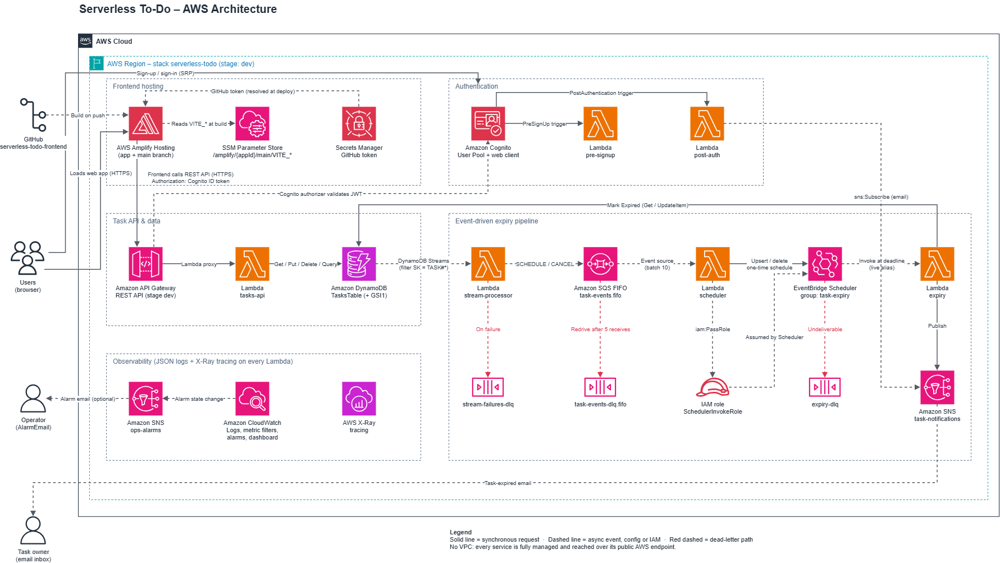

# Serverless To-Do: Backend

A serverless task manager with event-driven task expiry. Authenticated users create, view, update and delete
tasks; a task still **Pending** at its deadline is marked **Expired** and its owner gets an email.

All infrastructure, including the Amplify-hosted frontend, is defined in one AWS SAM template,
[`template.yaml`](template.yaml), and deployed by a GitHub Actions pipeline. The frontend code lives in
[serverless-todo-frontend](https://github.com/muhumuza-ivan/serverless-todo-frontend).

## Architecture



The editable source is [`architecture.drawio`](architecture.drawio) (open it in [draw.io](https://app.diagrams.net));
[`architecture.drawio.svg`](architecture.drawio.svg) is a scalable export.

| Area | Services | What happens |
|---|---|---|
| Frontend hosting | Amplify Hosting, SSM Parameter Store, Secrets Manager | Amplify builds the frontend from GitHub on every push. Backend settings (`VITE_*`) reach the build as Amplify secrets stored in SSM; the GitHub token comes from Secrets Manager. |
| Authentication | Cognito User Pool, 2 Lambda triggers | Email/password sign-up. **PreSignUp** auto-confirms the user; **PostAuthentication** subscribes the user's email to the notifications topic. |
| Task API | API Gateway (REST), Lambda, DynamoDB | The frontend, running in the browser, calls the REST API with the user's Cognito ID token. A Cognito authorizer validates the token, CORS allows only the Amplify app's origin, and one Lambda serves all CRUD routes against a single DynamoDB table. |
| Expiry pipeline | DynamoDB Streams, Lambda, SQS FIFO, EventBridge Scheduler, SNS | Task changes are turned into one-time schedules that fire at each deadline (see below). |
| Observability | CloudWatch, X-Ray, SNS | JSON logs, business metrics, alarms, an operations dashboard and tracing on every function. |

SNS sends each new subscriber a confirmation email; users must click its link before they receive expiry emails.

There is no VPC: every service is fully managed and reached over its public AWS endpoint.

### Task expiry workflow

```
TasksTable ──stream──▶ stream-processor ──▶ task-events.fifo ──▶ scheduler ──▶ EventBridge Scheduler
                                                                                     │ at deadline
                                                       owner's inbox ◀── SNS ◀── expiry ◀┘
```

1. **stream-processor** reads the table's stream (filtered to task items) and decides what each change means:
   - a new Pending task, a task reopened to Pending, or a Pending task with a new deadline → `SCHEDULE`
   - a Pending task completed or deleted → `CANCEL`
   - anything else (for example a description edit) → ignored
2. It sends the event to the **SQS FIFO** queue with `MessageGroupId = taskId`, so events for one task are processed
   in order, and `MessageDeduplicationId = stream eventID`, so stream retries don't create duplicates.
3. **scheduler** creates, replaces or deletes a one-time EventBridge schedule named `task-<taskId>`. The schedule
   deletes itself after it fires.
4. At the deadline the schedule invokes **expiry**. It flips the task from Pending to Expired only if the task is
   still Pending *and* the deadline still matches, then publishes to SNS. The message carries an `email`
   attribute that matches the owner's subscription filter policy, so only the owner is emailed.

Every step is idempotent: replays create the same schedule again, deleting a missing schedule is a no-op, and
stale or duplicate firings change nothing. Failures end up in a dead-letter queue (`stream-failures-dlq`,
`task-events-dlq.fifo` or `expiry-dlq`), and an alarm fires when any of them has messages.

## Data model

One DynamoDB table (on-demand, streams, point-in-time recovery, encrypted) in a single-table design:

| Key | Value | Used for |
|---|---|---|
| `PK` / `SK` | `USER#<userId>` / `TASK#<taskId>` | Get, update and delete a task; list all of a user's tasks |
| `GSI1PK` / `GSI1SK` | `USER#<userId>` / `STATUS#<status>#<deadline>` | List a user's tasks by status, ordered by deadline |

Task attributes: `TaskId` (UUID), `UserId` (Cognito `sub`), `Email`, `Description`, `Date`, `Status`
(`Pending` | `Completed` | `Expired`), `Deadline` (ISO-8601) and `DeadlineEpoch`, `CreatedAt`, `UpdatedAt`,
and `NotifiedAt` once the expiry email has been sent.

Rules enforced by the API:

- New tasks start Pending; the deadline defaults to 5 minutes after creation.
- Only the system sets Expired. Expired tasks are read-only and can only be deleted.
- A deadline must be at least 1 minute ahead (giving the pipeline time to register it) and within one year.
- A Completed task can be reopened only while its deadline is still ahead.
- Updates are conditional on the task's current status, so an update that races with expiry fails with `409`
  instead of overwriting it.

## API

Base URL: the `ApiUrl` stack output. Every request needs the user's Cognito **ID token** in the `Authorization`
header.

| Method | Path | Purpose | Success |
|---|---|---|---|
| `GET` | `/tasks?status=Pending\|Completed\|Expired` | List the user's tasks (status filter optional) | `200` |
| `POST` | `/tasks` | Create a task: `description` (required), `date`, `deadline` | `201` |
| `GET` | `/tasks/{taskId}` | Get one task | `200` |
| `PUT` | `/tasks/{taskId}` | Update any of `description`, `date`, `status`, `deadline` | `200` |
| `DELETE` | `/tasks/{taskId}` | Delete a task | `204` |

Errors: `400` invalid input, `401` missing or invalid token, `404` task not found, `409` the change conflicts
with the task's state.

## Security

- **Least-privilege IAM:** each function has its own role, scoped to its own log group and the exact resources it
  uses (for example, the tasks API can only `Get/Put/Delete/Query` the table, and the scheduler can only manage
  `task-*` schedules in its own group). EventBridge Scheduler assumes a separate role that can only invoke the
  expiry function and write to its DLQ, and its trust policy is limited to this account's schedule group.
- Users can only reach their own tasks: the partition key comes from the token's `sub` claim, never from the
  request.
- CORS allows only the Amplify app's URL. DynamoDB and SQS are encrypted at rest.

## Observability

- Structured JSON logs for every function, kept for 14 days (`LogRetentionDays`).
- Metric filters turn log lines into business metrics: `SchedulesCreated`, `SchedulesCancelled`, `TasksExpired`
  and `ExpiryNotificationsSent` (namespace `ServerlessTodo/dev`).
- Alarms on Lambda errors, API 5XX responses, dead-lettered messages, task-event backlog and stream lag. They
  notify the `ops-alarms` SNS topic, which emails `AlarmEmail` if one is set.
- An operations dashboard (link in the `OperationsDashboardUrl` output) and X-Ray tracing on the API and
  every function.

## Deploying

### Prerequisites

- AWS SAM CLI, Java 21 and Maven
- A Secrets Manager secret named `serverless-todo/github-token`, holding a plain-string GitHub token that can read
  the frontend repository (Amplify uses it to connect to GitHub)

### Manual deploy

```bash
sam build
sam deploy          # stack serverless-todo-dev in eu-west-1, settings from samconfig.toml
```

Optional parameters (`--parameter-overrides`):

| Parameter | Default | Purpose |
|---|---|---|
| `AlarmEmail` | *(empty)* | Email subscribed to operational alarms |
| `AllowedOrigin` | *(Amplify app URL)* | CORS origin override, e.g. `http://localhost:5173` for local frontend work |
| `LogRetentionDays` | `14` | CloudWatch Logs retention |
| `FrontendRepositoryUrl`, `FrontendBranch` | frontend repo, `main` | What Amplify builds |

After the first deploy, the Amplify branch builds automatically. The app URL is in the `AmplifyAppUrl` output.

### CI/CD pipeline

[`.github/workflows/pipeline.yaml`](.github/workflows/pipeline.yaml), generated by `sam pipeline init` and adapted
for this project:

1. **Unit tests** (`mvn verify`) on every push and pull request to `main`.
2. **Build and package** (`sam build` and `sam package`) on `main`.
3. **Deploy dev** (`sam deploy`) on `main`.

The workflow signs in to AWS through GitHub OIDC, so there are no long-lived keys. It reads these repository secrets,
created by `sam pipeline bootstrap`: `TESTING_PIPELINE_EXECUTION_ROLE`, `TESTING_CLOUDFORMATION_EXECUTION_ROLE`
and `TESTING_ARTIFACTS_BUCKET`.

## Testing

```bash
mvn -f backend/pom.xml verify                         # unit tests for every handler
tests/integration/smoke.sh serverless-todo-dev        # end-to-end checks against a deployed stack
```

The smoke test needs the AWS CLI, `curl` and `jq`. It signs up a throwaway user, checks auth, CORS and CRUD, then
waits for one task to expire and checks that a completed task did not. Finally it deletes its tasks and the user.

## Stack outputs

| Output | Description |
|---|---|
| `AmplifyAppUrl` | Frontend URL |
| `ApiUrl` | Tasks REST API base URL |
| `Region`, `UserPoolId`, `UserPoolClientId` | Frontend configuration |
| `OperationsDashboardUrl` | CloudWatch operations dashboard |
| `TasksTableName`, `TasksTableStreamArn` | DynamoDB table and its stream |
| `TaskNotificationsTopicArn`, `OpsAlarmsTopicArn` | SNS topics |
| `AmplifyAppId` | Amplify app ID |

## Repository layout

```
template.yaml               SAM template: all infrastructure, including Amplify
backend/                    Java 21 Lambda functions (one Maven project)
  api/                      tasks REST API: routing, validation, business rules
  auth/                     Cognito PreSignUp and PostAuthentication triggers
  stream/                   DynamoDB stream → SQS FIFO
  scheduler/                SQS FIFO → EventBridge Scheduler
  expiry/                   marks tasks Expired and notifies the owner
  shared/                   task model, DynamoDB mapping, AWS clients
tests/integration/smoke.sh  end-to-end test against a deployed stack
architecture.drawio(.png/.svg)  architecture diagram
```
